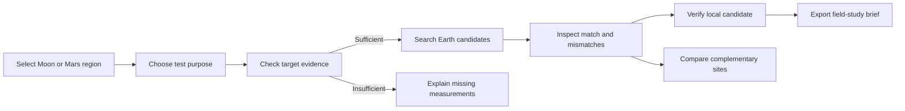
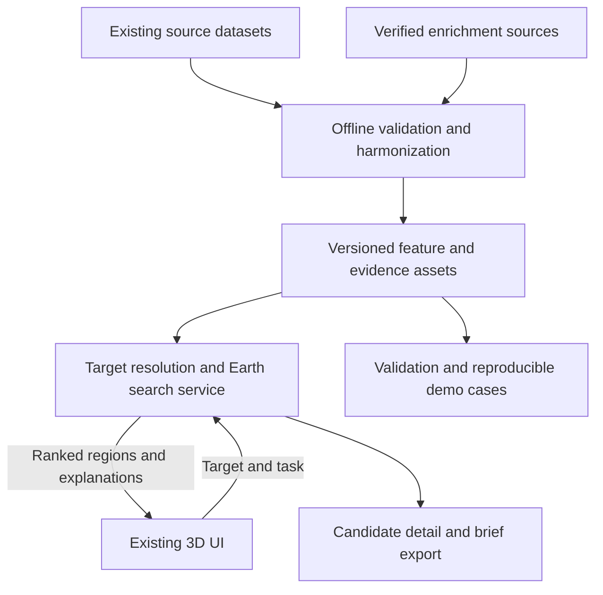

# TerraTwin — Master Project Blueprint

**Version:** 1.0 · **Prepared:** 2026-11-06 · **Status:** actionable design proposal based on the supplied challenge, the team briefing, the audited local datasets, and the user's working 3D map UI.

**Product statement:** Choose a place on the Moon or Mars, choose what you want to learn or test, and discover Earth locations that offer the relevant conditions—with evidence explaining both the analogy and its limits.

**Recommended emphasis:** task-specific discovery, explainable comparisons, and documented Earth candidates. The working 3D maps provide the entry point. The scientific comparison and the findings provide the value.

This blueprint defines the intended product; each capability requires implementation and validation before being claimed. Competition placement cannot be guaranteed. The recommendations aim to strengthen the project's relevance, originality, scientific credibility and presentation.

**Implementation update, 2026-11-06:** the verified three-body release `prepared/0.2.0` includes Earth land-cover/aridity screening, with 100,797 eligible Earth cells, and the independently checked 204-month vegetation series as provisional, unscored context. Predeclared reference checks, retrieval sensitivity, globe-ready cases, a [Gobi candidate dossier](analysis/GOBI_CANDIDATE_BRIEF.md) and a [Jaflong local-patch investigation](analysis/JAFLONG_LOCAL_PILOT.md) exist. Common-scale polar matching, definitive vegetation units, deployed UI integration and field validation remain incomplete. See [the preparation results](analysis/PREPARATION_RESULTS.md) for measured results and current limits; the milestones below describe the full product, not a declaration that every step is finished.

## 1. Executive decision

Build **an interactive analog discovery and test-planning application** around the existing Moon/Mars/Earth visualization. Support selecting arbitrary planetary locations, with clear responses where the available data cannot support a comparison. Include carefully characterized example regions for a reliable demonstration.

The strongest submission will demonstrate this complete sequence:

> A target region has a specific exploration need → Earth observations identify plausible analog regions → the user sees what matches and what differs → finer evidence characterizes a finalist → the application explains a concrete scientific or operational use.

Deliver three memorable capabilities:

1. **Search by testing purpose.** The same planetary location can have different Earth analogs for terrain navigation, volcanic field geology or cold/dry field operations.
2. **Explain every recommendation.** Show supporting measurements, decisive mismatches, data coverage, source resolution and rank stability. Explain why one site outranks another.
3. **Connect global discovery to local use.** Let users apply a travel radius, inspect candidate footprints and open a documented field-study brief. A two-site plan is a valuable extension when two separate tests need different environments.

The minimum convincing deliverable is a working search plus at least one carefully characterized Earth candidate. A gallery of attractive Earth pins without a defensible discovery method is insufficient.

## 2. Existing foundation and confirmed gaps

| Asset | Confirmed status | Consequence |
|---|---|---|
| Interactive 3D UI | Working, according to the user; source code not present in this workspace | Integrate with its renderer and events; do not schedule a globe rebuild |
| Earth table | 1,413,693 rows, 49 feature columns | Sufficient regional search volume |
| Moon table | 259,200 rows, 87 feature columns | Rich context with important regional gaps |
| Mars table | 1,036,800 rows, 92 feature columns | Rich context, including coarse modeled climate |
| Joint Earth availability | 889,525 rows have five core terrain measures, mean temperature and defined lithology | Starting population for analysis, before vegetation/land-cover/task screening |
| Main Parquet storage | Approximately 310.98 MB across the three bodies | Backend-scale data; a small frontend payload must be derived separately |
| Terrain resolution | Roughly 470 m source DEMs aggregated into regional cells | Supports regional terrain resemblance, not wheel-contact hazards |
| Earth environment | Land cover, aridity and the complete provisional NDVI series integrated in 0.2.0 | Dry/barren regional screening is available; no seasonal or current-condition claim |
| Antarctic temperature/geology | Missing from the supplied Earth products south of 62 S | Polar results need enrichment or explicit partial coverage |
| Shackleton center cell | Missing terrain; thermal/illumination fields present | Mechanical comparisons must be unavailable until suitable polar terrain is added |
| Jezero center cell | Core terrain present | Suitable for an initial regional test case; crater center is not a delta or landing ellipse |

Earth shares 47 feature names with Mars and 36 with the Moon. Shared names alone do not establish scientific comparability. Water indices, solar-power indices, categorical geological units and temperature extrema require special handling.

Detailed evidence is in [the dataset readiness report](analysis/dataset_readiness_report.md), [the blueprint technical review](analysis/blueprint_technical_review.md), and [the measured audit](analysis/dataset_audit.json).

## 3. Positioning and innovation

NASA already provides a [Planetary Analog Explorer](https://science.nasa.gov/solar-system/analog-explorer/) showing Earth/planetary examples, while USGS publishes [known analog-site data](https://www.usgs.gov/data/known-terrestrial-analog-sites-planetary-science). TerraTwin should cite these as useful foundations. The following differentiators are proposed product contributions, not a claim that nobody has attempted similar research.

| Capability | User benefit | Demonstration of value | Priority |
|---|---|---|---|
| Task-specific analog search | Finds environments relevant to an actual experiment | Change the task while holding the planetary target fixed; explain the changed ranking | Essential |
| Evidence and mismatch panel | Makes recommendations inspectable | Display an actual match, its largest mismatch, and its source footprints | Essential |
| Comparison of two candidates | Makes ranking understandable | Explain the two or three measurements responsible for A outranking B | Essential |
| Regional-to-local inspection | Converts a broad search into a plausible field location | Zoom from a regional result to finer imagery and terrain for a finalist | Essential for one pilot |
| Travel-radius search | Makes the tool useful to resource-limited teams | Show the strongest supported nearby results, including a truthful no-match outcome | High |
| Explain the nearest feasible alternative | Helps users act when their constraints fail | Compute the nearest radius containing an eligible region, or show which stated preference excludes it; require the user to accept any change | High, after radius search |
| Complementary two-site plan | Covers separate test requirements when one site cannot | Show which test occurs at each site and what the second site adds | High, after single-site validation |
| Discovery review against known sites | Encourages useful, less-documented candidates | Compare results with a known-site inventory, then record literature checks | High |
| Seasonal suitability | Finds the relevant time of year for local work | Compare measured seasonal vegetation, snow or dryness | Later; requires time series |
| Solar-angle field window | Helps plan a camera/navigation exercise | Calculate date-specific Sun altitude/azimuth with terrain limitations | Later |
| Measurement-priority guidance | Tells a team how to reduce uncertainty | Identify a missing property that could change a candidate's suitability | Later; do not invent expected information gain |

The most effective novelty story is the combination of a selected planetary region, a declared testing purpose, an evidence-backed search, and a usable local investigation plan. A larger feature count or an unsupported “AI accuracy” claim will not establish that value.

A useful research extension is a **terrain fingerprint**: compare distributions of slopes, roughness and terrain classes across equal-sized physical regions instead of relying on their means. Two regions can have the same average slope while one is uniformly gentle and the other mixes cliffs with flats. Existing cell summaries support an initial distribution comparison; claims about spatial arrangement or small obstacles need adequate underlying rasters and scale validation. Evaluate this extension against the simple baseline before presenting it as an improvement.

## 4. Product scope

### First-release comparison profiles

| Profile shown to users | What it can establish | Required evidence | Status |
|---|---|---|---|
| Terrain and navigation | Regional slope/relief resemblance for route planning and field exercises | Common-scale terrain, valid footprint, land cover for the intended exercise | Regional screening implemented; matched physical footprints still needed |
| Volcanic field geology | Broad material/process context and accessible exposed-terrain candidates | Explicit geology crosswalk, terrain, vegetation/exposure screen, regional geological references | First release after enrichment |
| Cold/dry field operations | Relevant terrestrial cold/dry conditions for selected field procedures | Seasonal temperature definitions, aridity, vegetation and snow context | Conditional; does not claim complete lunar/Mars thermal equivalence |
| Cave reconnaissance | Context around verified Earth caves and planetary openings | Catalog provenance, cave type, verified location and local terrain | Research extension |
| Ice drilling | Potential field context for a defined ice-related experiment | Subsurface ice properties, depth and mechanical evidence | Unavailable until appropriate evidence exists |
| Wheel traction or drillability prediction | Predicted hardware performance | Soil/mechanical properties, hardware geometry and validated physical model | Outside the first release |

Terrain is useful for rover testing, but the UI must not label regional terrain resemblance as a validated traction prediction. Likewise, a volcanic lithology label does not provide rock hardness.

### Operating assumptions

- Initial audience: university rover teams, planetary science students and researchers investigating candidate analogs.
- Scope: research and field-test planning; conclusions remain tied to the measurements actually available.
- Initial operating scale: the existing approximately 2.71 million total cells, a small demonstration audience, and one backend service. Use a ten-concurrent-query workload for an initial benchmark, not as a statement of anticipated demand.
- Data processing occurs offline. Query serving uses versioned prepared data and has no mandatory live upstream data call.
- Location entry is optional; do not persist a user's travel origin by default. Public scientific data require no user accounts for the first release.
- The team owns source manifests, data refreshes, model versions and rerun instructions. Dataset updates require repeating validation before promotion.
- Preserve the existing UI framework. The brief suggests React/FastAPI, but the actual frontend stack remains unverified.
- Performance targets below are proposed engineering budgets. They are not measured achievements.

## 5. User journey and interface

### Step 1 — Select a planetary target

The user selects Moon or Mars and clicks the globe. Resolve the hit to body-specific coordinates and display an explicit target footprint. Permit selecting a region rather than pretending a click is a point measurement. Offer named examples, but arbitrary locations must use the same data rules.

Show: name or coordinates, footprint, available evidence, source resolution, and supported comparison profiles. A region outside essential coverage receives an explanatory state and an option to select another region; never substitute a named demonstration target silently.

### Step 2 — Define the purpose

Ask “What do you want to study or test?” Show a small number of profiles. Each profile has required conditions and preferences. A user can adjust preferences without removing mandatory evidence checks.

Provide separate controls for desired analogy, geographic travel constraint and display settings. Explain any filter that removes candidates. A low vegetation threshold should not be imposed globally on tasks that do not require bare terrain.

### Step 3 — Explore Earth candidates

Fly the Earth view to a small number of geographically distinct candidate regions. Show region boundaries, not only center pins. At global zoom, cluster results; at local zoom, expose supported detail.

Result cards show the task fit, evidence availability, geographic scale, main reason for the match, strongest mismatch and known-site review state. A score is a documented fit index, not a probability of successful hardware testing.

### Step 4 — Inspect the evidence

Use a measurement table or dot plot with units alongside any radar chart. Show comparable features on the same scale, and keep unavailable values visibly missing. Separate absolute physical values from relative ranks.

The key comparison is: “Why this location, and what would fail to transfer?” A user should be able to answer it without reading code or a technical paper.

### Step 5 — Turn a result into an investigation

Open a field-study brief containing the target and Earth footprints, task, observations, limitations, sources, evidence dates, suggested checks and an export. Describe a proposed experimental use without claiming land access or measured mechanical properties.

If a second independent test is selected, show whether a two-site plan improves coverage. Keep the original single-site recommendation visible for comparison.

Use the current 3D UI for this flow. For mobile or limited GPU capacity, a single-map view with a body toggle and accessible result list is an acceptable presentation of the same functionality. Scientific results must not depend on animation or WebGL availability.

## 6. Scientific comparison rules

### Target definition and spatial scale

1. Record body, coordinate reference, longitude convention, target geometry and geometry source. Normalize longitude deliberately; test the antimeridian and poles.
2. Associate every feature with its native footprint and aggregation method. A rendered polygon smaller than the source footprint does not increase measurement resolution.
3. Compare region summaries over equivalent physical support where possible. Use area weighting, especially on latitude-longitude grids. Record boundary inclusion and partial-cell treatment.
4. For the first release, native grid-cell comparisons are allowed with an explicit regional label. For curated targets and local finalists, derive fixed-physical-scale summaries. Do not imply these two levels provide identical information.
5. Preserve slope/roughness baseline: terrain from 30 m and 470 m source spacing cannot be directly treated as the same measurement. Keep common-scale comparison features and fine local inspection features separately named.

### Feature policy

| Quantity | Ranking treatment |
|---|---|
| Slope distribution | Primary terrain descriptor; avoid counting several closely related statistics as independent dimensions |
| Relief and roughness | Useful at matched support; use representative features or a declared group weight |
| Absolute elevation | Context by default because body reference surfaces and interpretations differ |
| Terrain-derived hazard indices | Display as context; do not add their full weight to the underlying slope/roughness features |
| Geological units | Versioned category/process crosswalk with explicit unknowns; never numeric subtraction of category IDs |
| Temperature | Harmonize the statistic and temporal sampling first; otherwise compare descriptively and flag the mismatch |
| Water/solar indices | Do not directly compare incompatible body-specific indices |
| Cave distance | Context with catalog coverage caveats; a nearest catalog point is not evidence of a cave in the cell |
| Crater density | Specialized impact profile only, with preservation/catalog differences explained |
| Earth vegetation/aridity | Task-specific eligibility/context; not fictional Moon/Mars NDVI/rainfall values |
| Coordinates and cell IDs | Location and retrieval only; exclude from physical similarity features |
| Quality/error fields | Eligibility and uncertainty handling; do not count as additional scientific similarity dimensions |

Earth median slope/TRI correlation is 0.985, and relief/roughness correlation is 0.956 in the audited tables. Use these findings to limit repeated terrain influence. Correlation alone does not establish that two measurements are scientifically interchangeable.

## 7. Similarity, evidence and uncertainty

### Recommended baseline

Use an explicit weighted mixed-feature distance with physical tolerances or documented robust scaling. This is easier to audit than a learned embedding and does not require nonexistent analog training labels. Preserve a simple terrain-only baseline for evaluation.

For a comparable scalar feature i:

`distance_i = min(abs(earth_i - target_i) / tolerance_i, 1)`

For categorical features, use an explicit crosswalk and documented compatibility costs. Distributional features can be compared through selected quantiles at matching spatial support. All tolerances, costs and group weights belong to a versioned profile. Initial engineering values are hypotheses to validate, not established planetary similarity laws.

For the profile's full feature set F and its comparable observed subset O:

`coverage = sum(weight_i for i in O) / sum(weight_i for i in F)`

`observed_fit = 100 * sum(weight_i * (1 - distance_i) for i in O) / sum(weight_i for i in O)`

`supported_fit_lower = 100 * sum(weight_i * (1 - distance_i) for i in O) / sum(weight_i for i in F)`

`possible_fit_upper = supported_fit_lower + 100 * (1 - coverage)`

The lower/upper values describe mathematical bounds under unknown feature contributions, not statistical confidence intervals. Missing evidence stays labeled unknown even though the conservative lower bound grants it no credit. If O is empty, the result is unavailable rather than a numerical score.

Enforce finite nonnegative weights, positive total weight, positive finite tolerances, and compatibility costs between zero and one. Apply group weights before feature weights so adding another correlated descriptor does not automatically increase the influence of its dimension. A hard constraint remains a constraint even if its display weight is reduced.

Mandatory features must be comparable and available. As an initial engineering rule, require at least 80% weighted coverage for a ranked profile result; validate this rule and document exceptions by profile. Show coverage separately. Rank eligible candidates conservatively, then group nearby results so one landscape does not occupy the entire list. Availability does not establish accuracy; source quality and scale compatibility are additional checks.

### Ranking explanations

For each result expose the highest positive contributions, strongest mismatches, absent measurements, and rejected essential conditions. Pairwise comparison should explain the features responsible for rank differences using the same scoring calculation.

Weight changes are user preference experiments. Explain which preference changed the result; do not describe changing weights as discovering a new physical property of the landscape.

### Sensitivity and uncertainty

Repeat selected queries under reasonable alternative weights, scaling choices, boundary definitions and feature exclusions. Where a source supplies validated uncertainty, propagate it appropriately. Do not invent error distributions for sources that lack them.

Report retention in the top candidate set or rank ranges under these declared variants as **stability**, not accuracy. Nearby correlated cells must not be treated as independent evidence. Similarity, completeness, source quality and stability remain separate concepts in the UI.

## 8. Complementary two-site planning

Use the feature only when the user specifies separate tests. A pair must never be presented as a place where incompatible conditions coexist.

Let each complete test j have importance p_j and supported utility u_j(site), with all simultaneous requirements for that test evaluated at the same site. The portfolio utility is:

`portfolio(A, B) = sum(p_j * max(u_j(A), u_j(B))) / sum(p_j)`

Compare this with the best single-site value. Display the improvement and which site serves which test. Travel distance can be a declared constraint or a separately displayed tradeoff; do not mix kilometers and similarity without a stated normalization.

Evaluate pairs from a spatially diverse shortlist, for example at most 100 candidate regions (4,950 unordered pairs), rather than all 1.41 million cells. The shortlist size is an implementation choice to benchmark.

Illustrative use: one site supports a terrain navigation exercise and another offers relevant volcanic field geology. Both purposes need their own evidence. If no site satisfies a thermal or drilling requirement, the plan must report that gap. Splitting a single simultaneous slope-plus-temperature test between two sites does not satisfy it.

## 9. Discovering and characterizing less-documented analogs

Use known analogs as references and controls. Maintain three distinct review states:

- Known analog: a relevant inventory or publication documents the use.
- Candidate requiring review: retrieved by TerraTwin; not yet checked adequately.
- Less-documented candidate: inventory and targeted literature checks completed, with the exact search scope recorded.

Absence from a catalog is not proof of novelty. Distance from known sites is not a scientific suitability score. Identify scientifically eligible candidates first, then present documentation status as a separate discovery filter.

For each finalist, obtain coordinates/footprint, imagery, regional geology, finer terrain if needed, evidence dates and a clearly stated testing purpose. Confirm that the relevant material is exposed rather than merely mapped below vegetation or cover. Record practical access as unknown unless researched.

For the submission, aim for three case studies: a known analog used as a sanity check, a less-documented candidate with independent evidence, and a nearby regional candidate relevant to the team. These are proposed deliverables, not existing discoveries. Do not force a local example to qualify when its evidence does not support the claim.

## 10. Dataset preparation work packages

### D1 — Freeze and inventory inputs

Record checksums, provenance, download date, source epoch, units, coordinate frames, effective resolution, source type and license/attribution references. Keep input files immutable and write prepared outputs separately.

Account for the actual providers: NASA, USGS, NOAA, ECMWF/Copernicus, OpenLandMap, Natural Earth and the relevant scientific/community catalogs. NASA data should contribute to the method, with visible lineage from each scientific result to its sources.

### D2 — Apply explicit quality rules

Validate IDs, coordinate bounds, finite values, categorical vocabularies, physical ranges and internal relationships. Investigate suspect Earth land-mask cells, retain reason codes and allow task-specific eligibility views. Treat missing, zero and not-applicable as different states.

The audited 889,525 joint-complete Earth rows are an availability baseline. Do not globally delete other rows: terrain-only and polar-specific uses may have different required features. The complete core-terrain subset already excludes the low-validity cells missing roughness; partial-feature queries still need explicit QC.

### D3 — Build comparison definitions

Create a feature registry, explicit body applicability, measurement definitions, category crosswalks, feature groups, scaling rules and required-feature lists. Rename or prohibit misleading shared indices. Mark geological `undefined` as unknown even though it is non-null.

### D4 — Enrich Earth selection evidence

Priority additions are vegetation, land cover/bare-ground context, precipitation and climatic aridity. NASA [MODIS vegetation indices](https://modis.gsfc.nasa.gov/data/dataprod/mod13.php) and [TerraClimate](https://www.climatologylab.org/terraclimate.html) are candidate sources; product version, temporal baseline, QA, spatial support and suitability must be checked before use. Aridity from precipitation and reference evapotranspiration must handle zero/invalid denominators and distinguish climatology from seasonal dryness.

Retain seasonal summaries for the local pilot where feasible. A single annual value cannot establish the best testing month. Do not assume that low NDVI indicates dryness or absence of life.

### D5 — Prepare supported planetary targets

Start with the existing planetary tables and verified target geometries. Add appropriate [NASA lunar polar topography](https://pgda.gsfc.nasa.gov/products/78) for selected south-polar regions. Recompute comparable terrain summaries rather than filling missing slopes from nearby cells.

Separate floor, rim and terrain subregions where their use differs. A named feature footprint from the [USGS Gazetteer](https://planetarynames.wr.usgs.gov/) is not automatically a mission landing boundary. Record body-specific coordinate/control networks.

### D6 — Produce regional candidate tables and local evidence

Create compact backend tables for all supported cells, eligibility flags for each profile, and spatially grouped candidate footprints. Keep source-level and feature-level missingness. Prepare fine data only for shortlisted regions and one local pilot to control download and processing scope.

Use current source coverage to make a useful regional release while explicitly marking incomplete polar profiles. Do not advertise globally complete cold/dry coverage before the Antarctic gap is addressed.

### D7 — Validate and release a data version

Run the acceptance checks below, generate summary counts and manifests, and freeze the exact dataset/profile versions used in the demo. Make reruns possible without overwriting the audited inputs.

### Planned output contract

| Planned artifact | Contents |
|---|---|
| `prepared/<version>/earth_features.parquet` | Stable IDs, location/footprint references, comparable features, quality and availability flags |
| `prepared/<version>/planetary_features.parquet` | Body, source cell/region IDs, comparable features, applicability and coverage |
| `prepared/<version>/targets.json` | Named/preset target geometries, coordinate metadata, source references and supported modes |
| `prepared/<version>/feature_registry.json` | Meaning, units, source type, native support, comparability, transformations and limitations |
| `prepared/<version>/profiles.json` | Required features, grouped weights, tolerances, coverage rules and calibrated/experimental status |
| `prepared/<version>/provenance.json` | Source versions, checksums, citations, derivations and attribution |
| `prepared/<version>/validation.json` | Counts, failures, coverage, stability experiments and benchmark conditions |
| `prepared/<version>/case_studies/` | Verified evidence for selected candidates, their limitations and review status |

These paths describe the intended product contract. Implemented releases and the exact current filenames are documented in [the preparation results](analysis/PREPARATION_RESULTS.md) and [the app data handoff](analysis/APP_DATA_HANDOFF.md); some advanced artifacts remain roadmap items.

## 11. Application architecture and existing UI integration

Prefer offline preparation plus a small query service connected to the current UI. Python is suitable for the existing audit/preparation work. [DuckDB](https://duckdb.org/docs/stable/data/parquet/overview) can operate on Parquet, and [FastAPI](https://fastapi.tiangolo.com/) provides a typed API option consistent with the original brief. If an equivalent backend already exists, reuse it. Avoid introducing a new database/service solely for the prototype.

### UI integration responsibilities

- Convert a globe selection to body/latitude/longitude and a visible target geometry. Verify texture orientation and east/west convention with known control points.
- Keep map camera state separate from selected geographic state. Show target and result footprints independently of zoom.
- Cancel or ignore stale search responses when the user changes location/task quickly.
- Use stable candidate IDs for selection, compare and export. Preserve query/profile versions in shared results.
- Load small result payloads and detailed assets on demand. Do not transfer the complete raw tables to the browser.
- Keep actual source imagery distinct from illustrative graphics, and expose valid attribution.

### Minimal proposed API contract

| Endpoint | Purpose | Essential return data |
|---|---|---|
| `GET /v1/catalog` | Profiles, dataset versions and presets | Supported modes, feature definitions and current data version |
| `POST /v1/targets/resolve` | Validate arbitrary point/region selection | Normalized geometry, target summary, source support and allowed profiles |
| `POST /v1/search` | Search using target, profile, preferences and optional radius | Candidate regions, fit/evidence fields, explanations, exclusions and versions |
| `GET /v1/candidates/{id}` | Inspect a versioned result or region | Local evidence, footprint, sources and limitations; version/query context required |
| `POST /v1/plans/compare` | Compare single-site and two-site options | Test allocation, incremental benefit, remaining gaps and constraints |
| `POST /v1/briefs` | Export the selected result | Reproducible query, evidence and citations |

Every search result must carry: candidate ID, footprint, representative coordinate, task/profile version, dataset version, observed fit, evidence coverage, supported-fit bound, per-feature comparisons, source IDs, missingness, geographic distance if requested, and review status. Include stability only when that analysis was actually performed.

Use JSON nulls rather than NaN/Infinity. Validate coordinate ranges, area/radius limits, maximum result counts and permitted feature/profile IDs. Never accept arbitrary SQL or filesystem paths from the client. Define distinct responses for invalid request, unsupported target, insufficient evidence, no acceptable match and service failure.

## 12. Implementation alternatives and decision log

| Option | Benefit | Main cost | Decision |
|---|---|---|---|
| Precomputed preset demonstrations only | Fastest reliable demo | Cannot fulfill arbitrary spot selection | Keep as explicitly labeled fallback/reproducible examples |
| Live queries over prepared features | Supports arbitrary targets, sliders and traceable results | Requires harmonization and validation | Recommended main architecture |
| Learned cross-planet embedding or end-to-end neural matcher | Research potential | No verified analog labels; harder explanations and validation | Defer pending baseline and suitable evidence |

| Decision | Reason and alternative considered |
|---|---|
| Reuse the working globe UI | Existing user investment; a renderer rewrite adds little scientific value |
| Start with terrain/navigation, then exposed volcanic context | Strongest available evidence; broad hardware-performance modes require missing properties |
| Separate fit, missingness and stability | A single “confidence percent” would hide different uncertainties |
| Use task-specific required conditions | Global all-feature matching would compare absent or irrelevant properties |
| Preserve arbitrary selection with data-aware responses | Preset-only behavior would underdeliver the user's stated interaction |
| Characterize a few finalists deeply | A meaningful discovered example supports the challenge better than thousands of unexplained pins |
| Treat two-site planning as an extension | Requires a valid single-site engine and separable tests |
| Retain a narrow role for physical calculators | A weight or solar-angle calculation does not simulate all planetary conditions |

These are explicit design recommendations for the requested blueprint. They are not claims of completed implementation or expert validation of chosen numerical parameters.

## 13. Performance, reliability and maintenance

Initial proposed acceptance budgets: p95 prepared-data search within 2 seconds for the ten-concurrent-query benchmark; immediate visible loading feedback; a normal ranked-result response below 1 MB excluding optional imagery; and interactive map behavior on the team's actual demo laptop. Record machine, dataset version, cache state and query mix.

The original 50 ms backend target can remain a later optimization goal for a bounded cached computation. Do not substitute it for an end-to-end measurement. Measure exact scans first; introduce indexing/approximate retrieval only if needed, and verify ranking recall against the exact method.

Query serving must work from prepared assets when source portals are unavailable. Live basemap/imagery dependencies may still need connectivity; prepare a truthful recorded demo and licensed/local assets for the curated cases where permitted. A cached example must retain its original query and version labels.

Data pipeline stages should be resumable and versioned. Keep dependency/environment instructions, source manifests and a single reproducible build entry point. Assign an owner to each data family and review outputs before changing the serving version.

## 14. Validation and definition of done

| Area | Required demonstration |
|---|---|
| Input integrity | Known source versions/checksums, unique IDs and valid coordinate/unit checks |
| Missingness | Missing essential target features produce unsupported status; no zero-filling or fabricated support |
| Scientific compatibility | No direct matching of incompatible water/solar scores or unaligned categorical codes |
| Geography | Correct hemisphere/longitude, antimeridian/polar behavior, footprints and physical-distance calculations |
| Quality control | Suspect partial-land cells and undefined geology are handled by every relevant profile |
| Arbitrary target behavior | Queries away from presets run through the same engine and coverage checks |
| Ranking | Compare the proposed method with a declared terrain-only baseline; document improvements and failures |
| Stability | Repeat key queries under alternative reasonable weights/scales/boundaries and report actual changes |
| Spatial validation | Separate neighboring cells/regions when tuning or evaluating; do not claim independent samples from repeated coarse inputs |
| Known analogs | Use profile-appropriate known examples as sanity checks, without tuning all parameters to make those sites win |
| Negative controls | Test inappropriate environments for the chosen task and insufficient-evidence cases |
| Discovery | Independently inspect at least one less-documented candidate; record literature search scope and uncertainty |
| Two-site logic | A pair improves separate test coverage; it never satisfies one simultaneous requirement by splitting it across sites |
| Performance | Record actual latency/payload/memory results and full demo workflow behavior |
| Explanation/export | A result can be traced from UI values to features, source versions and the ranking rule |

Useful quantitative measures include regional coverage by profile, number of geographically distinct eligible regions, top-K rank stability, blinded expert relevance where expert review is available, time to find an evidence-backed candidate in a small user exercise, and actual query latency. No unverified “95% accurate” claim belongs in the submission.

## 15. Competition strategy and demonstration

The official [2025 judging guidance](https://spaceapps-v2-staging.s3.amazonaws.com/media/documents/Final_Space_Apps_2025_Judging_Guidelines_for_web.pdf) provides a useful precedent: impact, creativity, validity, relevance and presentation. This review has not verified the final rules for the user's applicable edition. Check those rules before submission; do not infer current deadlines or media limits from older guidance.

| Judging dimension | Evidence TerraTwin should present |
|---|---|
| Impact | A concrete rover/science-team task and an example of how the tool narrows the search |
| Creativity | Task-dependent discovery, explicit analog limitations, and complementary test planning |
| Validity | Audited sources, defensible comparison rules, measured validation and honest failure states |
| Relevance | A selected planetary target connected to a characterized terrestrial candidate using actual mission/Earth data |
| Presentation | One coherent selection-to-explanation story, visible measurements, and a clear testing use |

This is a recommended evidence strategy, not an assessment score or a prediction of award results. Best Use of Science/Data and Local Impact are plausible thematic alignments under the older award descriptions; avoid optimizing the product around unverified current award categories.

### Demonstration story

1. Start with an actual team problem: “We need a terrestrial region to practice navigation across terrain resembling this Mars region.”
2. Select the region on the working globe and show the task and target evidence.
3. Reveal geographically distinct Earth candidates generated from the prepared data.
4. Open one candidate: show the strongest match, one material difference and the sources.
5. Change the task or travel radius and explain the changed recommendation.
6. If ready, show a second site covering a separate test; otherwise finish with the field-study brief.

Use a supported Mars or lunar target for the main demonstration. Include a short secondary example showing the system correctly refusing an unsupported claim. Shackleton should become a headline mechanical case only after polar terrain has been integrated and checked.

Prepare a short teaser and a longer live walkthrough. Fit the submitted media to the actual edition's rules. Do not display invented candidate scores, undiscovered-site claims or simulated validation statistics. If AI assists code or presentation, follow the applicable disclosure rules and identify sourced scientific measurements separately from generated text.

### Suggested pitch

> TerraTwin helps exploration teams find Earth environments for specific Moon and Mars tests. Select a planetary region and a task, and it searches open observations for relevant Earth candidates, explains the similarities and limits, and produces an evidence-backed field-study brief.

## 16. Milestones and team ownership

Use completion gates rather than a promised ten-minute processing run or an unsupported calendar estimate. The original briefing describes a six-person team; adjust ownership if the actual team differs.

| Milestone | Primary owner | Deliverable | Gate |
|---|---|---|---|
| M0: Connect target selection | Frontend + backend | Existing globe emits verified coordinates/geometry; typed response displayed | Known control points and unsupported-target state work |
| M1: Prepare first data version | Two data/GIS leads | QC tables, registry, profiles and provenance | Audit reruns, no silent imputation, clear coverage |
| M2: Complete first search | Backend/algorithm lead | Terrain profile, explanations, geographic grouping and radius filter | Arbitrary supported target returns real candidates |
| M3: Characterize and enrich | Data/GIS + research lead | Vegetation/aridity/material evidence, selected polar repair and local pilot | At least one finalist has independent local evidence |
| M4: Complete evidence UI | Two frontend/UI leads | Candidate footprints, units-based comparison, sources and brief | User can explain why a result was recommended |
| M5: Add distinctive extension | Backend + research | Two-site plan or seasonal local search, chosen by available evidence | Demonstrable benefit over single-site/baseline approach |
| M6: Validate and present | Whole team; research lead coordinates | Benchmark, case studies, honest limitations and demo | Full story reproducible from pinned data/profile versions |

M0 and data preparation can proceed concurrently as team work. Do not let optional feature work delay the first real result flowing into the existing UI. Stabilize the demo before spending remaining time on extra visual effects.

## 17. Risks, fallbacks and release boundaries

| Risk | Response |
|---|---|
| Earth enrichment access fails | Keep terrain-only searches available with accurate labels; do not invent bare-ground/aridity screening |
| Polar terrain cannot be prepared in time | Use supported targets for mechanical demonstration and retain explicit polar coverage limits |
| No defensible novel candidate emerges | Present reproducible candidate discovery and characterize a promising location without claiming novelty |
| Local travel radius has no adequate match | Report the gap; let the user deliberately expand distance or change the task |
| Similarity scores are sensitive to weights | Expose stability and choose conclusions supported across reasonable settings |
| Model/imagery resolution is too coarse | Keep results regional and acquire local evidence for finalists |
| Two-site extension is incomplete | Submit the complete single-site workflow and documented findings |
| UI stack differs from the briefing | Adapt the API boundary to the working frontend |
| Deadline is short | Prioritize one supported profile, arbitrary selection, a real candidate and evidence/export before extensions |

Explicit release boundaries: no claim of certified landing/base safety, exact lunar traction from ballast removal, underground ice accessibility from snow proxies, confirmed caves from nearest-candidate distance, or complete biological equivalence. These boundaries follow the actual scientific claims in the original brief and the supplied data.

## 18. Immediate next work

The initial terrain preparation, callable search, historical land-cover/aridity screening and two finer investigations now exist. Use the measured status in [PREPARATION_RESULTS.md](analysis/PREPARATION_RESULTS.md) rather than interpreting this roadmap as unfinished work in every area.

1. Locate the working frontend and establish the globe-selection event and geographic conventions.
2. Connect the versioned search callable to Earth footprints and per-feature explanations, using [APP_DATA_HANDOFF.md](analysis/APP_DATA_HANDOFF.md).
3. Show the resolved source cell immediately. Boundary tests found that tiny click movements can switch whole regional summaries and completely change the top-ten list.
4. Demonstrate Jezero → screened Gobi candidate → finer terrain and material mismatch → proposed navigation investigation. Preserve the honest empty Sylhet and unsupported Shackleton cases.
5. Before expanding the scientific scope, derive comparable physical footprints, broaden independent evaluation and obtain material/field evidence for the proposed task. Add a second comparison profile or two-site plan only when that evidence exists.

The principal unresolved integration input is the frontend repository/framework. The main product direction is established by the user's request. Engineering defaults in this document can be refined during implementation without reopening the core concept.

## 19. Source and status notes

Inputs: the challenge text supplied by the user; the two-page TerraTwin team briefing at `/home/mashrafi/Downloads/TerraTwin Team Briefing & Project Blueprint.pdf`; the user's statement that the 3D map UI works; local measured audits and technical review linked above. Online references are placed beside the claims or recommendations they support.

The audit and subsequent processing establish dataset contents, a working screening method and documented candidate investigations, not ground-truth analog suitability. Product ideas, unimplemented profiles, future architecture and milestones remain recommendations. Use the linked measured results for actual candidate identities, processing checks and benchmark scope. Final competition rules and deployed UI behavior still require confirmation for the team's submission.
