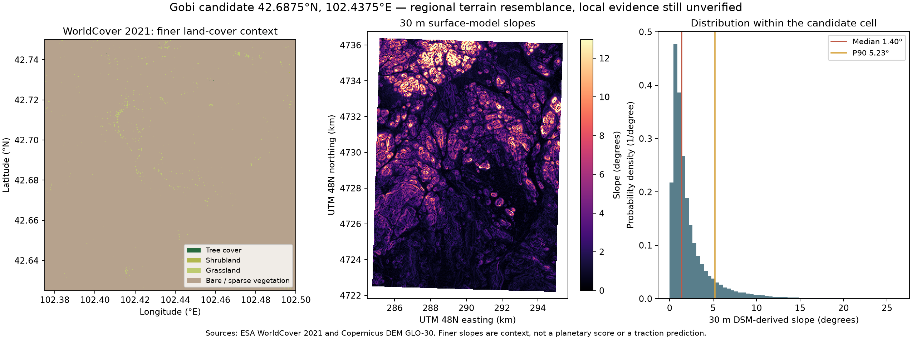

# TerraTwin candidate brief: a Gobi regional terrain match

**Finding:** the Earth cell centered at **42.6875°N, 102.4375°E** is a plausible candidate for investigating dry, predominantly exposed terrain for route-planning exercises. The evidence supports regional screening and closer investigation. It does not establish a verified Mars analog, a newly discovered site, or a usable field location.

The cell was selected by the archived Jezero-center terrain query, then examined with separate climate, land-cover and finer elevation data. This sequence is a practical demonstration for the existing globe: show the regional resemblance, reveal the supporting evidence, and then show what changes at finer resolution.

## The actual comparison

The selected Earth footprint covers about **142.01 km²**, bounded by 102.375–102.5°E and 42.625–42.75°N. The requested Mars coordinate, 18.41°N, 77.69°E, resolves to a **208.40 km²** native cell. These are source-cell footprints; neither is a surveyed field site or a mission landing ellipse. Their unequal areas pass the current experimental ratio check but remain a scale limitation.

| Regional feature | Jezero containing cell | Gobi candidate cell |
|---|---:|---:|
| Median slope | 0.557° | 0.565° |
| 90th-percentile slope | 1.232° | 1.294° |
| Relief | 148.00 m | 149.54 m |
| RMS roughness | 10.164 m | 10.188 m |

The four-term score is **99.72/100** under the declared tolerances. It is an uncalibrated resemblance score, not 99.72% confidence or overall suitability. The similarity of these summaries does not show that the two terrains have the same spatial arrangement, materials, boulders or traversability. See the exact contributions and original result in [the prepared metadata](../prepared/gobi_candidate_0.1.0/metadata.json).

## Separate environmental evidence

The historical Global AI/ET0 v3 annual aridity index is **0.03613**, with complete valid support for this cell. That satisfies TerraTwin's declared AI ≤0.2 Earth screen. This is precipitation divided by reference evapotranspiration for **1970–2000**, not a measurement of Martian aridity or present-day weather. Its storage scale is provider-documented; a missing-data correction prevents ocean-background zeros from being counted as dry observations. [Provider dataset](https://doi.org/10.6084/m9.figshare.7504448.v5).

The strictly classified **2017 MODIS** mosaic labels the cell as barren. An independent product, **ESA WorldCover 2021**, classifies **99.565%** of its area as bare/sparse vegetation, about **0.432%** as grassland and small fractions as tree/shrub classes. These are mapped classes, not measured mineral exposure or an accuracy percentage. WorldCover's input-quality layer was not acquired. Differences between the two products are not evidence of land-cover change because their class definitions and resolutions differ. [WorldCover product manual](https://esa-worldcover.s3.eu-central-1.amazonaws.com/v200/2021/docs/WorldCover_PUM_V2.0.pdf).

## The finer view changes the interpretation

Copernicus GLO-30 surface elevations were projected to UTM 48N at 30 m, with slopes calculated by central finite differences. The selected footprint contains 158,100 valid output pixel centers:

| Finer Earth context | Result |
|---|---:|
| Median surface-model slope | 1.40° |
| 90th-percentile slope | 5.23° |
| 99th-percentile slope | 12.96° |
| Pixel centers with slope above 5° | 10.84% |
| Pixel centers with slope above 10° | 2.39% |
| Surface-model relief | 181.19 m |

These differ markedly from the integrated regional summaries. That is a resolution/method diagnostic, not proof that either source is wrong. The finer slopes are **not** inserted into the planetary score: Mars has not been recomputed with the same inputs and method. Copernicus is a surface model, includes editing and multiple source epochs, and does not resolve wheel-contact obstacles. [Source documentation](https://copernicus-dem-30m.s3.amazonaws.com/readme.html).

The PDF version of this figure was rendered and visually inspected. All extracted source windows and prepared outputs have local checksums. Remote whole-file checksum verification is not claimed for these COG windows.

## Material and novelty checks

The supplied Earth geology maps the dominant unit as `carbonate.sedimentary.rock`, occupying about **71.3%** of the cell. Its broader category is `other`. This coarse label does not establish exposed materials in a chosen local plot and must not be relabeled as basalt. In-situ research at Jezero has identified aqueously altered igneous crater-floor units; generic carbonate-related terminology is not a demonstrated material match. The crater's center cell must also be distinguished from its delta and rover traverse. [USGS publication record](https://www.usgs.gov/publications/aqueously-altered-igneous-rocks-sampled-floor-jezero-crater-mars).

The Gobi already appears in Mars-analog research. Scuderi and Mason studied Gobi deltas as potential Jezero-delta analogs, while a 2020 study examined Mongolian closed-basin lakes. These papers establish prior regional research; they do **not** characterize our selected cell or show that it contains those study features. A search failing to find this coordinate would not establish novelty. The candidate remains **“novelty not established.”** [Gobi delta study](https://www.hou.usra.edu/meetings/terrestrialanalogs2021/pdf/8083.pdf), [lake hydrogeochemistry study](https://doi.org/10.3390/min10090792).

## A concrete use and the next measurements

A defensible proposed experiment is a **route-planning and navigation exercise on a subsequently surveyed local plot**. Compare routes planned from coarse and fine terrain data with field-measured slopes, traveled distance and localization drift. This tests how terrain representation affects planning. It does not predict wheel traction, construction suitability or rover survival on Mars.

Before calling any part of the cell a field-test site, obtain current imagery, delineate an actual test footprint, survey slope/obstacle distributions, characterize the exposed material and check access and land-use conditions. Thermal, atmospheric, radiation and gravity equivalence are not provided by this location. No field visit, permission, current condition or operational suitability has been verified.

For integration, use [the candidate GeoJSON](../prepared/gobi_candidate_0.1.0/candidate.geojson), preserve its evidence status, and display the footprint rather than only a point pin. This is a candidate dossier that demonstrates TerraTwin's method, not a confirmed discovery.
