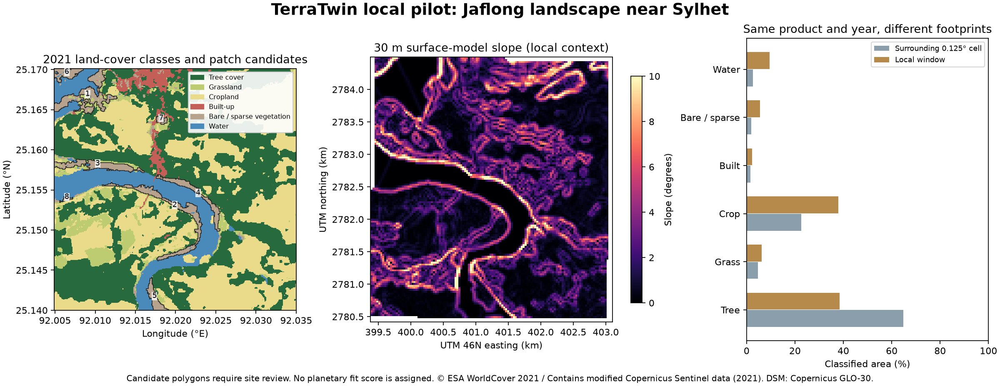

# Jaflong local pilot: finding useful patches inside a poor regional match

**Result:** a small, explicitly selected window near Jaflong contains eight connected areas classified as bare/sparsely vegetated in ESA WorldCover 2021, each at least 0.5 hectares. These are candidates for further inspection, not verified planetary analogs or approved field-test grounds.

The current output is [prepared/local_pilot_0.1.1](../prepared/local_pilot_0.1.1/metadata.json). Version 0.1.0 is retained as an earlier immutable output; use 0.1.1 because it adds water-editing and crop-boundary flags.

## Why this changes the product design

The surrounding 0.125° Earth cell is only **1.97% bare/sparse class**, while the local window is **5.48%**. Within that window, discrete patches range from approximately **0.50 to 13.35 hectares**. Both percentages use the same WorldCover 2021 product, so this comparison isolates footprint effects rather than mixing products or years.

A region-wide 80% barren-class requirement would reject the surrounding cell. That is reasonable for an exercise requiring a predominantly barren region, but it can hide smaller exposed surfaces relevant to a different task. TerraTwin should therefore distinguish regional analog screening from local patch investigation. The latter should be offered for a declared activity, such as investigating navigation or traverse-planning exercises, with the missing field evidence visible.

The pilot does not make Jaflong a lunar thermal, geochemical, vacuum, gravity or Martian atmospheric analog. It also does not establish rover traction, wheel sinkage or bearing strength. Those properties are not measured by these satellite products.

## What was acquired and measured

The analyst-selected window spans approximately 92.005–92.035°E, 25.140–25.170°N. The actual extracted raster includes intersecting edge pixels and extends slightly beyond those requested bounds. Bangladesh Water Development Board's registry lists the Jaflong_Spill station at 25.156°N, 92.018°E inside the window; that station helps locate the landscape but is not proposed as a test site. [BWDB registry](https://hims.bwdb.gov.bd/hydrology/includes/bm_pillar_sw_print.php?dist=&river=).

- **ESA WorldCover 2021 v200:** approximately 10 m land-cover classes from Sentinel-1/2. Class 60 includes exposed or sparsely vegetated soil, sand and rock, including some disturbed surfaces. Its input-quality layer has not been acquired. A class label is not a local confidence estimate. [Product manual](https://esa-worldcover.s3.eu-central-1.amazonaws.com/v200/2021/docs/WorldCover_PUM_V2.0.pdf).
- **Copernicus GLO-30 DSM:** a surface model, including buildings and vegetation. The clipped DSM was projected to UTM 46N at 30 m for slope and terrain-context calculations. Its acquisition epoch differs from the 2021 land cover. [AWS product description](https://copernicus-dem-30m.s3.amazonaws.com/readme.html).
- **Regional geology:** SPARRSO documents gravelly sand and marsh clay/peat within the wider Jaflong region. Those regional descriptions do not establish the material at an individual candidate patch. [SPARRSO annual report, Geology Division, printed pages 28–29](https://sparrso.gov.bd/sites/default/files/files/sparrso.portal.gov.bd/annual_reports/0b6f4c6e_9faf_48ac_a8f7_16dfb644815e/2022-03-09-08-39-75d87c64703469c15254710071319051.pdf).

The two local source windows total approximately 63 KB on disk; the surrounding-cell WorldCover extract is about 119 KB. These are local output sizes, not measured network transfer totals: remote COG reads fetch compressed blocks and headers. Local window values and georeferencing were checked after export. Source URLs, original raster windows, remote ETags and local SHA-256 hashes are recorded; no whole-remote-file checksum verification is claimed.

## Candidate areas and the important terrain caveat

| Patch | Classified area (hectares) | Touches analysis crop boundary | Patch pixels within 30 m of mapped water |
|---|---:|---|---:|
| 1 | 13.35 | Yes | 44.3% |
| 2 | 12.00 | No | 67.7% |
| 3 | 8.38 | Yes | 39.6% |
| 4 | 6.55 | No | 53.4% |
| 5 | 3.87 | Yes | 34.3% |
| 6 | 3.65 | Yes | 79.4% |
| 7 | 0.80 | No | 0.0% |
| 8 | 0.50 | No | 87.7% |

These are classified raster-component areas, not surveyed usable-ground areas. Boundary-touching components may continue outside the crop. Distances to mapped water use pixel centers and local metric spacing; water beyond the crop is not assessed.

**Seven patches require review for potential water-editing effects in the DSM.** Copernicus DEM processing includes water flattening and river editing. Some pixels classified as exposed surface in 2021 may overlap a surface represented or edited as water in the older DSM. Very small or zero computed slopes therefore cannot establish flat exposed ground. The output flags proximity to water or a high fraction of numerically zero slopes; it does not diagnose editing as the proven cause. [Copernicus product handbook](https://dataspace.copernicus.eu/sites/default/files/media/files/2024-06/geo1988-copernicusdem-spe-002_producthandbook_i5.0.pdf).

The 30 m slope and plane-residual statistics remain local context. They are not inserted into the approximately 470 m planetary/Earth terrain comparison, and they are not described as boulder roughness. No planetary score is assigned to these patches. Even patch 7, which does not trigger the water-proximity rule, remains unverified.

## What the existing globe UI can use

Load [patch_candidates.geojson](../prepared/local_pilot_0.1.1/patch_candidates.geojson) as a separate local-investigation layer. Each feature includes a true classified footprint, a representative point inside the raster component, area, crop-boundary status, source year, DSM context, water-review flags, and explicit unknowns for materials, current condition and access. The numbering is by area, not analog quality.

Use a label such as “Exposed-surface candidates from 2021 observations.” Keep the regional terrain score and the local patch evidence separate. A concise evidence card can explain which task might justify inspection, which data support that investigation, and why no field-readiness claim is available yet.

Before proposing a test, the next evidence should include more recent imagery, seasonal water/land-cover behavior, an appropriate local terrain survey, material observations, and actual site-access review. A limited literature search and field review would be needed before making any novelty claim; no novelty claim is made here.
