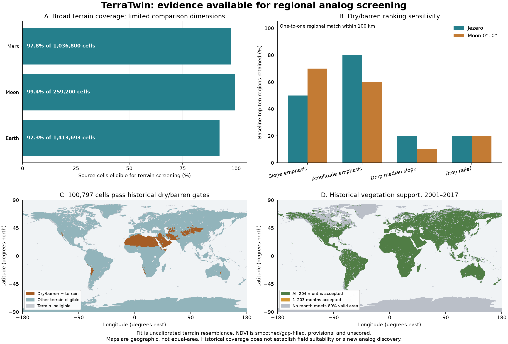

# TerraTwin: preparation results and scientific interpretation

> **Status update 2026-11-12:** Statements here that the frontend is absent or unconnected are outdated. The globe is now connected to analog retrieval through `/api/v1` (`frontend/terratwin_service.py`, `frontend/terratwin.js`). See [IMPLEMENTATION_STATUS.md](IMPLEMENTATION_STATUS.md) for what is implemented and verified. The text below is preserved as written.

**Use `prepared/0.2.0` and `prepared/app_0.2.0` for the completed regional screening data package.** It combines the original three-body measurements, Earth land-cover/aridity screening, and the full 2001–2017 vegetation series as provisional, unscored context. All 410 planned NDVI/aridity source files completed checksum verification. The existing globe's frontend code is not present here and its integration has not been verified.

The strongest product direction is **task-specific analog search with visible evidence and mismatches**, starting with regional terrain/navigation investigations. The [master blueprint](../TERRATWIN_MASTER_BLUEPRINT.md) specifies the broader design, innovations, architecture, validation and demonstration. The [data catalog](DATA_CATALOG.md) records sources and interpretation limits.

## Are these datasets sufficient?

**Yes for a regional terrain-screening prototype; no for an all-purpose physical Earth twin.** The Earth search population is substantial. Only a subset of the planetary features can be meaningfully compared with Earth, and finer observations are needed to characterize an actual field site.

| Body | Original cells preserved | Terrain-eligible cells | Original → current registered features |
|---|---:|---:|---:|
| Earth | 1,413,693 | 1,304,254 | 49 → 78 |
| Moon | 259,200 | 257,760 | 87 → 87 |
| Mars | 1,036,800 | 1,013,760 | 92 → 92 |

The 29 added Earth definitions comprise 14 land-cover/support fields, four aridity/ET0 fields and 11 vegetation/support fields. Spatial identifiers and operational flags are separate. There are **257 body-specific feature definitions**, but only **four terrain quantities** currently contribute to similarity. More columns do not automatically supply independent evidence. [Release summary](release_summary_0.2.0.json).

All original rows and finite source measurements remain; nonfinite values become explicit nulls. Preparation validates every original column, IDs, coordinates, row counts and checksums. Quality flags preserve missing terrain, inadequate source support, physical inconsistencies, undefined geology and missing temperature. Earth has 889,525 rows with the original five core terrain diagnostics, mean temperature and defined lithology, but those fields are not all scientifically comparable across bodies.

These are spatially correlated latitude–longitude cells of unequal physical area, not independent observations or distinct analog sites. Earth's source DEM is NOAA ETOPO at roughly 463 m equatorial spacing; lunar/Martian DEMs have similar nominal spacing but different effective resolution and interpolation. Equal nominal spacing is not full scale harmonization.

## What the search actually does

A Moon/Mars point resolves to its entire containing native cell. Earth candidates pass terrain quality checks and an experimental Earth/target area ratio of 2/3–1.5. The score uses median slope, p90 slope, relief and RMS roughness, each weighted 0.25. TRI is a terrain diagnostic, not a fifth score term.

For each quantity, the absolute difference is divided by a declared tolerance and capped at one. Fit is 100 times one minus the weighted mean of those differences. Tolerances are **5° median slope, 10° p90 slope, 500 m relief and 100 m RMS roughness**. These are uncalibrated engineering choices. A score of 95 is not 95% accuracy or a 95% probability of a useful analog. The default minimum fit is 50; returned centers are at least 100 km apart.

`terrain_screening` uses terrain eligibility. `dry_barren_terrain` also applies Earth-only historical environmental gates. Neither score includes temperature, numeric geology codes, water/illumination indices or provisional NDVI. The callable accepts arbitrary coordinates and optional origin/radius constraints; four exported cases are integration fixtures, not the only supported coordinates.

The defensible claim is: **“These regional cells resemble the selected regional cell on four terrain summaries.”** The method does not establish equivalent soil mechanics, chemistry, subsurface resources, biology, radiation, gravity, atmosphere or base suitability.

## Earth environmental screening

The dry/barren profile admits **100,797 Earth cells** before target-specific area, score, radius and separation checks. Thresholds are:

- Strict land-cover coverage ≥0.95 and valid aridity-area coverage ≥0.95.
- Barren-class fraction ≥0.8; water ≤0.05; built-up ≤0.01; crops/mosaic ≤0.05.
- Aridity index, precipitation/reference ET0, ≤0.2.
- Original terrain eligibility also passes.

The [2017 MODIS land-cover derivative](https://doi.org/10.5281/zenodo.8367523) has 916,840 cells with sufficient strict coverage; 105,337 also meet the barren threshold. Unclassified land defaulting to “barren” never counts as evidence. Six independent direct source-pixel checks passed. Fractions describe predicted classes, not measured bare-rock percentage. The derivative's license is CC BY-SA 4.0.

The [1970–2000 Global AI/ET0 v3 climatology](https://doi.org/10.6084/m9.figshare.7504448.v5) has 1,324,648 sufficiently supported cells; 392,327 also meet AI ≤0.2. Corrected processing requires valid positive ET0 at contributing pixels: AI alone lacks a nodata tag and uses zero for both dry land and ocean background. Valid dry zeros remain. Seven independent source-window checks passed. **Use `environment_0.1.0/aridity_0.1.1`; the old `aridity` output is superseded.** Provider license metadata and non-commercial-use text conflict; both are recorded without inferring clearance.

These thresholds are screening assumptions, not calibrated analog-success criteria. The historical periods differ, and neither product establishes current conditions or site access. [Land-cover checks](landcover_verification.json), [aridity checks](aridity_verification.json).

## Full vegetation series: complete processing, qualified evidence

The [monthly MODIS/AVHRR-derived product](https://zenodo.org/records/4305975) supplies 204 vegetation rasters and 204 QA masks for 2001–2017. Aggregation uses exact spherical pixel overlap. A month requires ≥80% valid-area support. Summary means average accepted monthly p90 composites; seasonal peak/minimum are extrema of twelve calendar-month climatologies, not daily extremes.

| Result | Earth cells |
|---|---:|
| All 204 months accepted | 770,147 |
| No month accepted | 643,546 |
| Dry/barren terrain cells with all 204 months | 100,021 |
| All 204 months and gap-filled area/time fraction ≤0.2 | 13,071 |
| Cells south of 60°S with any accepted month | 0 |

There are no partial-series cells under these rules. This does **not** mean 204 independent observed months: QA code 1 denotes gap-filled pixels and code 2 denotes smoothed pixels. Among supported cells, the median gap-filled area/time fraction is **57.9%** (10th–90th percentile: 31.1%–86.3%). These QA diagnostics must remain visible.

The derivative reports identity raster scale and omits an explicit storage multiplier. A factor of 0.0001 is inferred from its range and the [NOAA parent convention](https://developers.google.com/earth-engine/datasets/catalog/NOAA_CDR_AVHRR_NDVI_V5); it is not independent confirmation for this derivative. Raw and provisional scaled fields are exported. **NDVI affects neither eligibility nor ranking.** Low greenness also cannot prove bare rock or absence of biology.

Independent pixel intersections and separate temporal reductions passed at **six sites × 204 months**. This verifies computation, not undocumented units, gap-filling accuracy or field conditions. [Full-series verification](ndvi_verification.json).

| Diagnostic location | Provisional mean NDVI | Provisional peak climatology | Gap-filled area/time |
|---|---:|---:|---:|
| Yungay reference | 0.112 | 0.116 | 49.6% |
| Manaus forest reference | 0.858 | 0.866 | 73.8% |
| Gobi candidate | 0.084 | 0.089 | 52.3% |
| High-greenness Sri Lanka terrain candidate | 0.778 | 0.792 | 72.5% |

The January-only sample remains an historical diagnostic. Use the full series for current context, retaining the provisional-scale qualification.

## Validation, specificity and instability

Predeclared reference checks passed: Yungay passes the screen; Manaus forest fails it; Garwood Valley has insufficient evidence. Outcomes hold across their 3×3 neighborhoods. Cinder Lake fails the regional screen, an allowed diagnostic result: a useful local lunar-training landscape need not make its entire regional cell dry/barren. Four selected references are not a representative accuracy benchmark. [Control results](control_evaluation_0.2.0.json).

Of 98,158 Earth cells remaining after Jezero's environment/area filters, 11,190 score ≥95, 94 score ≥99, and three score ≥99.5. The lunar-equatorial counts are 25,951, 469 and 36 out of 86,164. These are correlated cells before geographic thinning, not independent test sites or statistical significance. [Score selectivity](score_diagnostics_0.2.0.json).

Top-ten retention under alternative settings, using one-to-one regional matching within 100 km:

| Query | Slope emphasis | Amplitude emphasis | Drop median slope | Drop relief |
|---|---:|---:|---:|---:|
| Jezero | 50% | 80% | 20% | 20% |
| Moon 0°N, 0°E | 70% | 60% | 10% | 20% |

No retention percentage is assigned to the empty Sylhet result. These are sensitivity diagnostics, not confidence probabilities. [Evaluation](evaluation_0.2.0/retrieval_evaluation.json).

Twenty-four arbitrary selections and four longitude-alias comparisons passed independent footprint checks, including poles/antimeridian. **Boundary sensitivity is severe:** moving a click 11.85 m across one boundary near Jezero, or 6.06 m across an equatorial lunar boundary, retained none of the top-ten Earth regions within 100 km. The entire regional cell changed; this is not terrain measured over those few metres. The UI must display the full source footprint. A fixed-physical-footprint method needs new preparation and evaluation. [Geography checks](geography_validation_0.2.0.json).

The upgrade audit confirms **90 prior Earth columns** remain identical, excluding only the deliberately changed vegetation-status field. Planetary files remain bit-identical; screening/ranking configuration and five real queries retain their IDs and scores. [Upgrade verification](release_upgrade_verification.json).

## Candidate investigations and truthful failure cases

**Gobi, 42.6875°N, 102.4375°E:** this 142 km² cell scores 99.72 against the Jezero center cell's four summaries. Finer 2021 WorldCover predicts 99.565% bare/sparse class. The 30 m DSM-derived p90 slope is 5.23°, versus 1.29° in the coarse source; different resolutions/methods remain separate from the score. Coarse carbonate-sedimentary lithology does not demonstrate material equivalence with Jezero. A proposed use is terrain-navigation/route-planning investigation followed by local measurement. [Gobi dossier](GOBI_CANDIDATE_BRIEF.md).

**Jaflong:** eight exposed-class patch candidates of approximately 0.5–13.35 hectares occur within the pilot window, although its surrounding regional cell is only 1.97% bare/sparse. Seven patches need review for potential effects of water editing in the DSM. They have no planetary score or field-suitability claim. [Local dossier](JAFLONG_LOCAL_PILOT.md).

**Near Sylhet:** the dry/barren Jezero query within 500 km returns no qualifying regional cell. With unchanged 0.1.1/0.2.0 gates and score, the nearest qualifying cell is about 982.7 km away by center distance, scoring 59.95. This is a diagnostic, not a travel recommendation or automatic radius relaxation. [Feasibility calculation](nearby_feasibility_0.1.1.json).

**Shackleton:** its original center cell lacks core terrain and returns `target_insufficient_evidence`. Separate NASA LOLA 400 m-baseline products provide context: a 10 km projected circle has median slope 30.37° and median roughness 1.95 m; the center pixel's slope is 2.90°. The circle mixes floor, walls and nearby terrain and is not a proposed rim base. These different definitions do not fill integrated fields or enable ranking. [Polar context](shackleton_polar_context.json), [NASA definitions](https://pgda.gsfc.nasa.gov/products/90).

Known-site review snapshots four general USGS portal records and 45 PAAD dune-field points. The inventories cannot certify novelty. Prior Gobi Mars-analog research is documented; this candidate is **not** claimed as a new discovery. [Review scope](KNOWN_ANALOG_REVIEW.md).

## Serving assets and measured performance

The prepared release occupies **424,147,544 bytes**, including metadata and the planetary union table. Keep it on the backend. `prepared/app_0.2.0` contains **348,711 bytes** of integration assets: four query cases, twenty Earth footprints, definitions, provenance, comparisons, historical context and sensitivity diagnostics. Optional dossier images/rasters are separate.

The warmed local callable benchmark includes compact JSON serialization:

| Workload | Median | p95 | Largest response |
|---|---:|---:|---:|
| Five sequential mixed queries | 0.175 s | 0.212 s | 29,154 bytes |
| Twenty queries with ten workers | 0.744 s | 0.792 s | 29,153 bytes |

Process peak RSS was about 795 MiB across imports, manifest reads and both runs. These are small local diagnostics with warm caches, excluding HTTP/network/globe latency. They meet the proposed 2-second callable p95 budget in this run; the original 50 ms aspiration was not achieved. [Benchmark conditions](benchmark_0.2.0.json).

The standalone [PDF figure](figures_0.2.0/dataset_diagnostics.pdf) was rendered and visually inspected. Earlier figures and [the 0.1.1 report](PREPARATION_RESULTS_0.1.1.md) remain separately available.

## Handoff and next product work

The analysis/preparation deliverables are ready for the existing globe: [integration contract](APP_DATA_HANDOFF.md), [reproduction instructions](../processing/README.md), [completion audit](COMPLETION_AUDIT.md). A deployed service and UI wiring remain to be implemented in the frontend project.

Next scientific priorities are matched physical terrain footprints, confirmed/replacement vegetation units, broader independent evaluation, and exposed material/local field evidence. Lunar polar matching, seasonal operational recommendations, chemistry equivalence, ice drilling and hardware predictions remain unsupported profiles or roadmap items. This is a defensible regional screening foundation, not a field-validated global analog-discovery product.
