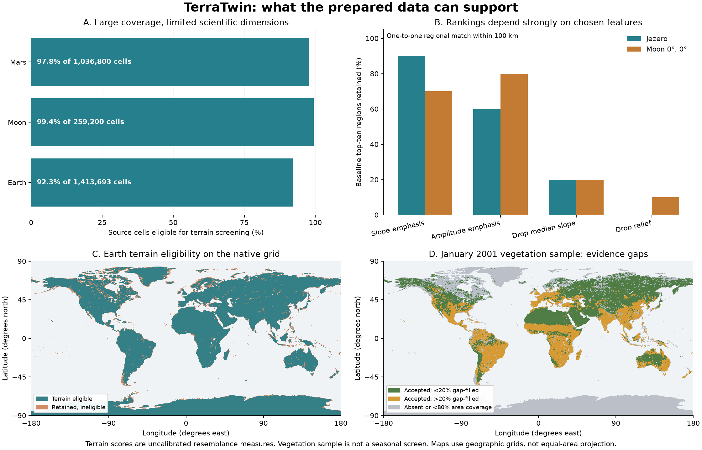

# TerraTwin: preparation results and scientific interpretation

**Status: working terrain retrieval with historical dry/barren Earth screening, reference checks and two finer-scale investigations.** Use `prepared/0.1.1` and `prepared/app_0.1.1` for this capability. Full NDVI processing is still in progress. This is a reproducible data foundation for the existing globe UI, not a field-validated global analog-discovery product. The master product design remains in [the blueprint](../TERRATWIN_MASTER_BLUEPRINT.md).

## What has actually been prepared

| Body | Source cells preserved | Eligible for terrain screening | Terrain + temperature + defined geology |
|---|---:|---:|---:|
| Earth | 1,413,693 | 1,304,254 | 889,525 |
| Moon | 259,200 | 257,760 | 254,783 |
| Mars | 1,036,800 | 1,013,760 | 1,013,760 |

All original rows and finite source measurements remain. Nonfinite values become explicit NULLs. The preparation checks every original column, row counts, identifiers, coordinates, and input checksums. Quality flags distinguish missing terrain, inadequate DEM support, physically invalid values, undefined geology, and missing temperature. Flags can overlap; their counts must not be added as disjoint categories. Source data remain unchanged.

The Earth table is large enough for a useful **regional terrain screening prototype**. Its size does not make every comparison scientifically supported. A shared column name is insufficient evidence that the underlying measurements are comparable. The prepared registry records policies for all 228 body-specific feature definitions.

The source-cell totals are not independent observations or counts of analog sites. Latitude–longitude cells vary in physical area, and adjacent cells are spatially correlated. Counts alone cannot establish global representativeness, effective sample size, or coverage of particular field environments.

## What the retrieval currently means

A requested Moon/Mars coordinate resolves to its containing native grid cell. Earth candidates must pass terrain quality checks and an experimental Earth/target area ratio of 2/3–1.5. The score uses median slope, p90 slope, relief, and RMS roughness. TRI is required as a terrain diagnostic but is not counted as an additional score term. Temperature, water indices, illumination indices, and numeric geology identifiers are excluded from this shared score.

The normalized absolute-distance score uses declared, **uncalibrated** tolerances: 5° median slope, 10° p90 slope, 500 m relief, and 100 m RMS roughness. Each term has weight 0.25. Fit ranges from 0 to 100. It is not a probability or a measure of overall analog suitability. The minimum score of 50 and 100 km separation between returned candidate centers are engineering defaults requiring evaluation.

This method supports an honest claim: “These regional cells resemble the selected cell on four terrain summaries.” It cannot establish comparable dust mechanics, material strength, exposed geology, habitability, radiation, gravity, atmosphere, or suitability for a base. Such claims require different evidence and, in some cases, controlled experiments rather than an Earth location.

The area filter avoids some inappropriate relief comparisons but introduces a tradeoff: high-latitude planetary cells are physically smaller, so it can exclude lower-latitude Earth regions simply because their native cells are larger. **Fixed physical footprints and matched terrain baselines remain a priority**, particularly for lunar poles. The present area filter is not full scale harmonization.

## Measured retrieval and sensitivity results

Fifteen sequential local diagnostic queries took a median 0.177 seconds and p95 0.197 seconds. This includes prepared-file reads but excludes a web service, concurrent requests, network transfer, and globe rendering. It is not an application load-test result.

The table reports baseline top-ten regions retained under each alternative, using one-to-one matching within 100 km:

| Query | Slope emphasis | Terrain-amplitude emphasis | Drop median slope | Drop relief |
|---|---:|---:|---:|---:|
| Jezero center cell | 90% | 60% | 20% | 0% |
| Lunar coordinate 0°N, 0°E | 70% | 80% | 20% | 10% |
| Jezero, within 500 km of Sylhet | 90% | 90% | 90% | 70% |

These results show that the apparent precision of a ranked list can exceed its stability. The UI should expose which candidates persist across scenarios. Retention is not a confidence probability: scenarios are deliberately chosen, correlated tests, not independent statistical trials. The lunar equatorial example is an arbitrary coordinate, not a named proposed landing site.

Raw results and timing scope are in [retrieval_evaluation.json](retrieval_evaluation.json). Four-score explanations and geometries are in [queries](queries/).

## Environmental enrichment: processed sample and unresolved evidence

The selected vegetation source is OpenGeoHub's monthly MODIS/AVHRR-derived 5 km product. Its provider distinguishes disregarded pixels (0), gap-filled pixels (1), and smoothed pixels (2). Even flag 2 is a processed value, not an untouched observation. [Provider record](https://zenodo.org/records/4305975).

January 2001 has been processed across all 1,413,693 Earth cells. **770,147 cells** meet the sample's minimum 80% valid-area coverage. Values remain missing elsewhere; no-data is never interpreted as zero vegetation. The selected source does not provide qualifying January vegetation support for the 393,292 Earth cells between 90°S and 60°S in this table.

Aggregation calculates exact spherical source/target pixel overlap, including latitude-dependent area, instead of sampling cell centers. Tests cover zero-valued measurements, partial coverage, missing data, polar weighting, misaligned grids, and equivalence between full-grid and memory-bounded processing. The exported sample preserves source-area coverage and the fraction of valid area/time that was gap-filled.

The derivative's GeoTIFF metadata reports an identity scale, while raw values range from 5 to 10,000. A multiplier of 0.0001 is **inferred**, consistent with the documented NOAA parent convention, but not explicitly confirmed for this derivative. Raw values and clearly labeled provisional scaled values are both retained. This sample cannot yet support a definitive low-vegetation filter. [NOAA parent catalog and scale](https://developers.google.com/earth-engine/datasets/catalog/NOAA_CDR_AVHRR_NDVI_V5).

The sample already illustrates why terrain-only scores need context:

| Earth cell center | Jezero terrain fit | January provisional NDVI | Gap-filled fraction of valid area |
|---|---:|---:|---:|
| 42.6875°N, 102.4375°E | 99.72 | 0.069 | 0% |
| 7.1875°N, 80.0625°E | 99.63 | 0.784 | 100% |
| 25.4375°N, 28.9375°E | 99.60 | 0.115 | 0% |

These are **diagnostic examples, not verified analog nominations**. The second candidate's high provisional greenness would be relevant to a bare-terrain task, but its complete gap filling is also material. A single historical month cannot establish annual vegetation conditions. Low NDVI does not establish exposed rock, absence of life, or usable access.

The full acquisition plan covers 204 months from 2001–2017, their 204 quality masks, and the annual Global AI/ET0 v3 archive plus README: 410 files, about 4.09 GB. NDVI acquisition is still running; only checksum-verified completed files count as acquired. Current per-file progress is in `sources/enrichment_downloads.json`. Full NDVI climatology has **not** yet been published. Aridity is now processed, independently checked and integrated into release 0.1.1.

The aridity feature is precipitation divided by reference evapotranspiration. Its historical period is 1970–2000, different from the selected vegetation period. Its factor 0.0001 is documented. It screens Earth climate separately, without an invented lunar/Martian counterpart. The provider's CC BY 4.0 metadata conflicts with its non-commercial-use text; both statements are preserved. [Pinned source](https://doi.org/10.6084/m9.figshare.7504448.v5), [methods paper](https://www.nature.com/articles/s41597-022-01493-1).

The source AI raster has no no-data tag and contains zeros in both hyperarid land and ocean background. Corrected processing requires valid positive reference ET0 support at the corresponding pixel, retaining valid dry zeros. **1,324,648 cells** have at least 95% valid AI coverage; **392,327** also meet AI ≤0.2. Seven independent direct source-window checks passed. Use `prepared/environment_0.1.0/aridity_0.1.1`; the older `aridity` folder is superseded and must not be used for screening. Details are in [aridity_verification.json](aridity_verification.json).

## Shackleton: useful evidence without inventing a missing match

The original Shackleton center cell has no core terrain values. Retrieval returns `target_insufficient_evidence` and an empty candidate list.

Two independent NASA LOLA rasters have now been downloaded and locally hashed. They provide plane-fit slope and height-residual roughness at a 400 m baseline, sampled on a 1 km raster. A projected 10 km circle centered on the named crater center contains 313 valid pixel centers in each product. [NASA product definitions](https://pgda.gsfc.nasa.gov/products/90).

| Statistic | Plane-fit slope | Height-residual roughness |
|---|---:|---:|
| Pixel containing crater-center coordinate | 2.90° | 2.09 m |
| Median of pixels in the 10 km circle | 30.37° | 1.95 m |
| 90th percentile in that circle | 32.16° | 3.43 m |

The center-to-region slope difference is a concrete reason to ask users to select a meaningful target footprint. The circle mixes crater floor, walls, and nearby terrain; it is not a proposed rim base. The summary uses pixel-center inclusion in the source polar projection, not an exact geodesic area integral. These source definitions differ from the integrated terrain fields, so this supplement **does not overwrite those fields or enable a Shackleton ranking**. Full coordinates, CRS, hashes and definitions are in [shackleton_polar_context.json](shackleton_polar_context.json).

## Product-ready assets and remaining release gates

### Subsequent processing update

The 2017 MODIS land-cover and QC rasters are fully acquired, publisher-checksum verified, and aggregated for all 1,413,693 Earth cells. Of these, 916,840 have at least 95% strict classified coverage; 105,337 also have at least 80% barren-class area. QC=1 default barren labels never count as barren evidence. Six independent direct source-pixel window checks passed. Only three of Jezero's original top ten terrain matches meet these coverage/barren thresholds.

Release **0.1.1** integrates land cover and corrected aridity, preserving the original measurements. **100,797 cells** pass terrain eligibility and all declared environmental filters: strict land-cover coverage ≥0.95, AI coverage ≥0.95, barren-class fraction ≥0.8, water ≤0.05, built-up ≤0.01, crops/mosaic ≤0.05, and AI ≤0.2. These are explicit engineering screening choices. They do not measure analog accuracy or contemporary usability. NDVI is omitted from this release and never affects the score or gates; release 0.2.0 will add the complete series as provisional context only.

The predeclared center-cell checks passed: Yungay passed the environment screen, Manaus forest failed, and Garwood Valley returned insufficient evidence. Each result held across its 3×3 neighborhood. Cinder Lake failed the regional screen, as permitted by its diagnostic design: its local lunar-training value does not require an entire regional cell to be dry/barren. See [the control evaluation](control_evaluation_0.1.1.json). Four selected controls are not a representative accuracy benchmark.

The dry/barren profile returns no qualifying regional Jezero match within 500 km of the illustrative Sylhet origin. The nearest cell meeting the same minimum terrain fit and other filters is about **982.7 km** away by center-to-center great-circle distance; its terrain fit is **59.95/100**. This is a diagnostic, not a travel recommendation or an automatic relaxation of the user's radius. See [nearby feasibility](nearby_feasibility_0.1.1.json).

Fifteen local dry/barren queries took a median **0.095 s** and p95 **0.162 s**, excluding a web service and rendering. Jezero's top-ten regional retention under slope emphasis, amplitude emphasis, dropping median slope and dropping relief was **50%, 80%, 20%, 20%**. The corresponding lunar-equatorial values were **70%, 60%, 10%, 20%**. No retention percentage is assigned to the empty Sylhet result. These remain sensitivity diagnostics. [Versioned evaluation](evaluation_0.1.1/retrieval_evaluation.json).

A separate local pilot contains eight WorldCover-derived exposed-surface candidates near Jaflong. Their patch sizes range from about 0.5 to 13.35 hectares, despite only 1.97% bare/sparse class in the surrounding native Earth cell. Seven require review for potential water-editing effects in the finer DSM. This demonstrates both the value and the limits of local patch investigation; it does not establish a local Mars/Moon analog. See [the local pilot report](JAFLONG_LOCAL_PILOT.md).

A selected Gobi cell has separate historical aridity support and 99.565% bare/sparse class in finer WorldCover data. Its 30 m DSM-derived p90 slope is 5.23°, compared with 1.29° in its integrated regional summary. Different resolutions and definitions explain why a strong coarse match still requires closer terrain investigation. Its coarse carbonate-sedimentary geology is not a demonstrated match to Jezero materials, and prior Gobi analog research prevents a broad novelty claim. See [the candidate dossier](GOBI_CANDIDATE_BRIEF.md).

`prepared/0.1.0` remains the immutable terrain baseline. `prepared/0.1.1` adds historical environmental screening, and `prepared/app_0.1.1/cases.json` indexes four cases with twenty Earth polygons, score contributions, environment context and scenario-retention evidence. Sylhet and Shackleton intentionally have no Earth matches under the selected profile. Related Gobi and Jaflong dossiers are linked separately. These are practical integration assets for the existing 3D globe; they do not constitute the deployed application.

The strongest defensible product direction is **task-specific analog search with visible evidence and explicit failure to conclude when the evidence is insufficient**. The implementation now supports parts of that distinction: real footprints, explanations, proximity queries, missing-data responses, provenance, and sensitivity. A claim of newly discovered or confirmed analog sites must wait for independent local evidence.

Remaining work before a scientifically defensible broader release:

1. Complete and verify NDVI acquisition and processing; verify its scale or replace its source before a definitive vegetation gate.
2. Broaden the reference evaluation and obtain local material evidence; the four controls and remote-sensing investigations do not establish field suitability.
3. Recompute relevant targets and Earth candidates on compatible physical footprints/baselines, especially polar targets.
4. Characterize a small number of local candidate areas with imagery, primary geological evidence, and clearly scoped operational use. Search literature before making novelty claims.
5. Repeat ranking and boundary sensitivity checks, validate proposed tasks, and integrate the data-backed API with the existing UI.

Reproduction commands and output contracts are in [processing/README.md](../processing/README.md). The current scientific status is partial preparation, not completed external validation.
